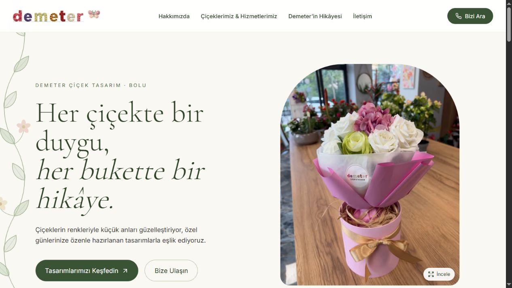
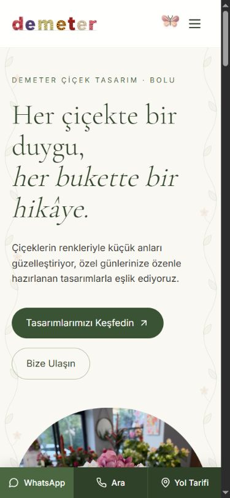
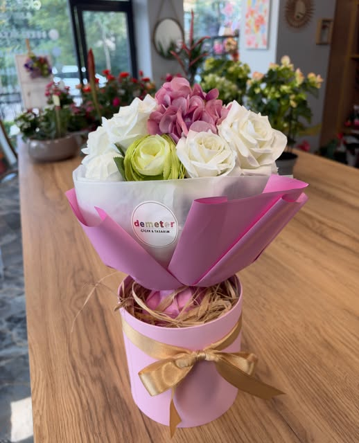
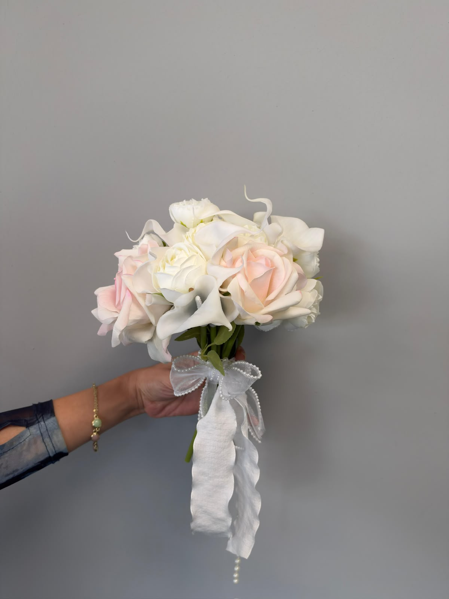
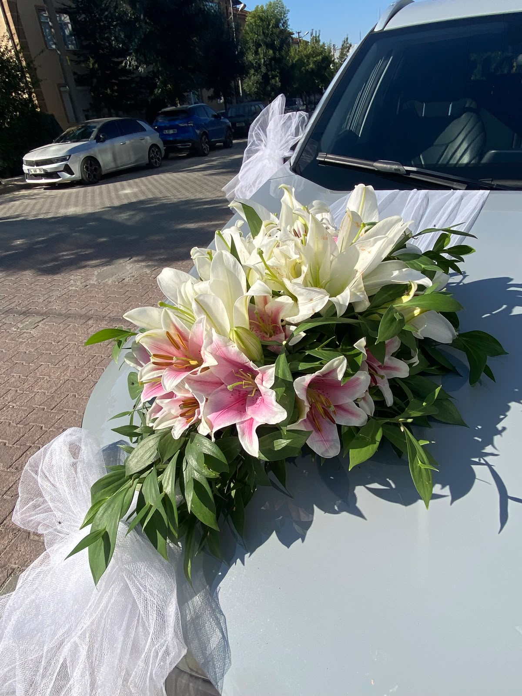
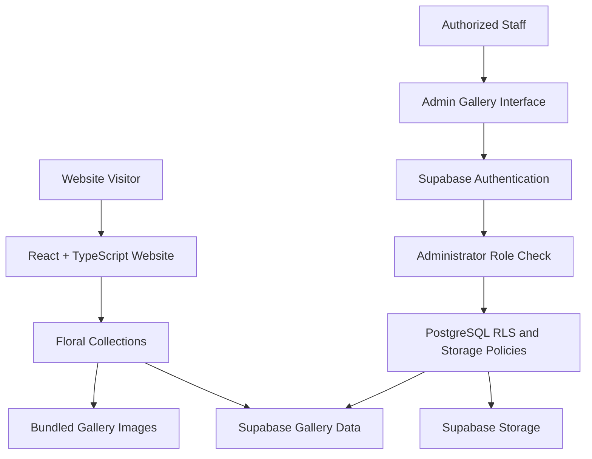

<div align="center">
  <a href="https://demetercicekcilik.com.tr/">
    
  </a>

  # Demeter Çiçek Tasarım

  **A modern florist website & gallery management experience for a real local business.**

  An elegant, mobile-first digital storefront built for a flower design studio in **Bolu, Türkiye** — combining thoughtful visual design, discoverable local content, and a focused content management workflow.

  [**🌐 Explore the Live Website**](https://demetercicekcilik.com.tr/) · [**📁 Browse the Source Code**](https://github.com/cemozkan1454/DemeterCicekcilik)

  <br />

  
  
  
  
  

</div>

---

## ✨ About the Project

**Demeter Çiçek Tasarım** is a production-oriented website developed for a florist in Bolu. Instead of a generic store template, the experience is built around the brand's floral identity: soft botanical colors, editorial typography, product photography, and intuitive navigation.

The project brings together two complementary experiences:

- **Customer-facing website:** A responsive, single-page presentation of floral collections, the brand story, and direct contact options.
- **Gallery management panel:** A restricted interface where authorized staff can manage the images shown under **“Çiçeklerimiz & Hizmetlerimiz”** without editing source code.

> **Project scope:** This is a business showcase and gallery CMS, not an e-commerce checkout system. Inquiries are directed to the florist via the site's contact channels.

## Website Preview

Screenshots of the live website captured on 22 October 2026. Gallery content can change as the business updates it.

### Desktop



### Mobile



## 🌷 Selected Project Visuals

These are **real image assets used by the website**, rather than simulated UI screenshots.

<table>
  <tr>
    <td width="33%" align="center"></td>
    <td width="33%" align="center"></td>
    <td width="33%" align="center"></td>
  </tr>
  <tr>
    <td align="center"><sub>Signature floral arrangements</sub></td>
    <td align="center"><sub>Bridal bouquets</sub></td>
    <td align="center"><sub>Wedding car decoration</sub></td>
  </tr>
</table>

**See the complete interactive experience:** [demetercicekcilik.com.tr](https://demetercicekcilik.com.tr/)

## 🚀 Features

### Public Website

- **Responsive, mobile-first layout** designed for desktop and mobile visitors.
- **Seven curated gallery categories:** Arrangements, Bouquets, Wreaths, Bridal Bouquets, Engagement & Proposals, Wedding Car Decoration, and Potted Plants.
- **Interactive product gallery** with category selection, horizontal navigation, and enlarged photo viewing.
- **Brand storytelling** through dedicated editorial sections and botanical visual details.
- **Quick contact actions** via WhatsApp, phone, Instagram, and map directions, including a mobile contact bar.
- **Local SEO foundations:** descriptive page metadata, canonical URL, Open Graph / social previews, sitemap, robots directives, and `Florist` structured data (JSON-LD).
- **Accessibility considerations:** semantic navigation, keyboard-aware image dialogs, accessible labels, and reduced-motion support where applicable.

### Admin Gallery Management

- **Supabase Auth sign-in** with an additional server-verified administrator-role check.
- **Category-based image management** across the same seven collections displayed on the public website.
- **Multi-image selection and upload**, with client-side resizing and compression before storage.
- **Caption editing, image deletion, cover image selection,** and image previews.
- **20-image limit per category**, enforced in the interface and supported by included database hardening scripts.
- **Supabase Database + Storage integration** for gallery metadata and image files.

> The admin interface is dedicated to managing gallery images and captions. It is not a general-purpose website editor.

## 🧰 Tech Stack

| Area | Technology | Responsibility |
| :--- | :--- | :--- |
| Frontend | React 18, TypeScript | Component-driven user interface |
| Build tooling | Vite 8 | Local development and production builds |
| Styling | Tailwind CSS 3, custom CSS | Responsive design and animations |
| Icons | Lucide React | Consistent iconography |
| Authentication | Supabase Auth | Admin sign-in |
| Database | Supabase PostgreSQL | Gallery content and role data |
| File storage | Supabase Storage | Uploaded gallery photos |
| Authorization | PostgreSQL RLS + RPC functions | Server-side access control |
| SEO | HTML metadata, JSON-LD, sitemap | Search engine discoverability |

## 🏗️ How It Works



- The website includes bundled collection imagery, so it can display content without a Supabase connection.
- When Supabase is configured, the gallery retrieves category images and metadata from the `gallery_photos` table.
- The admin panel works with the `gallery` storage bucket and database functions such as `is_gallery_admin()` and `set_gallery_cover()`.
- Access control depends on the **actual RLS and Storage policies deployed in Supabase**, not simply on hiding admin controls in the frontend.

## 📂 Project Structure

```text
DemeterCicekcilik/
├── public/
│   ├── images/                 # Brand and floral imagery
│   ├── robots.txt
│   └── sitemap.xml
├── src/
│   ├── components/             # Website sections and admin UI
│   ├── config/                 # Content, gallery categories, site metadata
│   ├── hooks/                  # UI behavior
│   ├── lib/                    # Supabase client and gallery repository
│   ├── App.tsx
│   ├── index.css
│   └── main.tsx
├── supabase/                    # Gallery schema and security SQL scripts
├── .env.example
├── package.json
├── SECURITY.md
└── README.md
```

## 💻 Run Locally

### Prerequisites

- Node.js **24** recommended for the Vite 8 toolchain used by this project
- npm
- A Supabase project **only if you want to enable the database-backed gallery and admin panel**

### 1. Clone the repository

```bash
git clone https://github.com/cemozkan1454/DemeterCicekcilik.git
cd DemeterCicekcilik
```

### 2. Install dependencies

```bash
npm ci
```

### 3. Start the development server

```bash
npm run dev
```

Open the local URL printed by Vite (typically `http://localhost:5173`). **The public website can be previewed with the bundled gallery images even without Supabase credentials.**

### 4. Optional: Configure Supabase

Copy `.env.example` to `.env.local` and replace the sample values with your own project's public client configuration:

```dotenv
VITE_SUPABASE_URL=https://your-project.supabase.co
VITE_SUPABASE_PUBLISHABLE_KEY=your-publishable-key
```

The repository contains SQL scripts in `supabase/` for gallery tables, role checks, storage policies, and additional security rules. **Review these scripts and the administrator assignment logic before applying them to any database**; do not run the scripts blindly against an existing production project.

Never place a Supabase service-role/secret key in any `VITE_` environment variable. Client-side keys are public; access must be restricted through correctly configured RLS, Storage policies, and administrator roles.

### Useful commands

| Command | Purpose |
| :--- | :--- |
| `npm run dev` | Start the development server |
| `npm run typecheck` | Check TypeScript types |
| `npm run lint` | Run ESLint |
| `npm run build` | Generate production files in `dist/` |
| `npm run preview` | Preview the production build locally |

## 🔐 Security Notes

The admin frontend checks the authenticated user with Supabase and verifies gallery-admin authorization. The database and storage layer must also enforce permissions through RLS policies and access-controlled functions.

Before deploying or reusing the admin setup, verify that:

1. Public account registration is disabled if only invited staff should log in.
2. Non-admin users cannot insert, update, or delete gallery records or storage objects.
3. Administrator assignment and storage access policies are correct for your Supabase project.

See [`SECURITY.md`](SECURITY.md) for the security review, testing notes, and remaining verification tasks recorded in the repository.

## 🎯 What This Project Demonstrates

- Delivering a real-world website based on a client's brand and business needs
- Converting a static promotional website into a maintainable, content-managed experience
- Designing reusable React components and responsive interfaces
- Integrating Supabase authentication, PostgreSQL, and object storage
- Applying local SEO fundamentals and accessibility considerations
- Separating public content from restricted administrative operations

## 👨‍💻 Developed By

**Cem Özkan**<br />
Management Information Systems Graduate · Frontend & Full-Stack Development

[GitHub Profile](https://github.com/cemozkan1454) · [Project Repository](https://github.com/cemozkan1454/DemeterCicekcilik)

---

<div align="center">
  <sub>Built for Demeter Çiçek Tasarım · Bolu, Türkiye</sub><br />
  <sub>Branding and floral photography are client-specific assets; do not reuse without permission.</sub>
</div>

## Deployment

Run `npm run build` and publish the `dist/` directory. Supply Supabase client environment variables at build time if the managed gallery is enabled. Configure an SPA fallback to `index.html` so direct visits to `/admin` work.

`public/_headers` contains hosting-specific security headers. When using another Supabase project, update its Content Security Policy to allow that project's image and API endpoints. On hosts that do not support `_headers`, configure equivalent headers through the hosting service.
